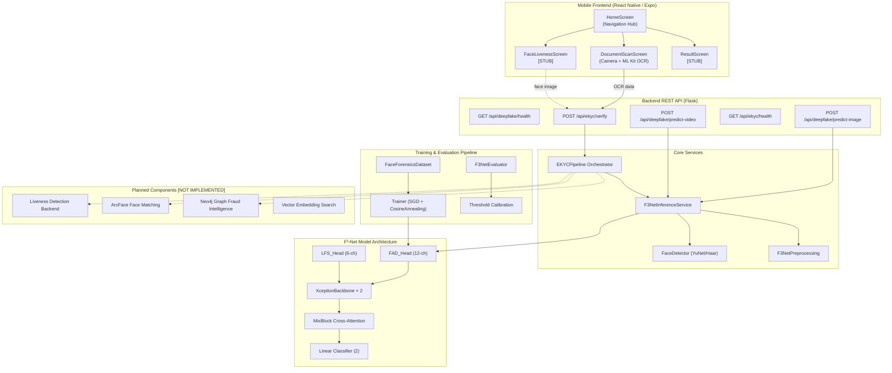
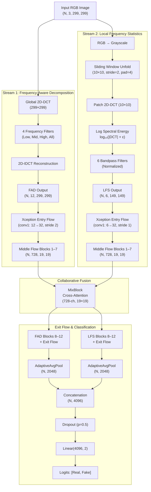
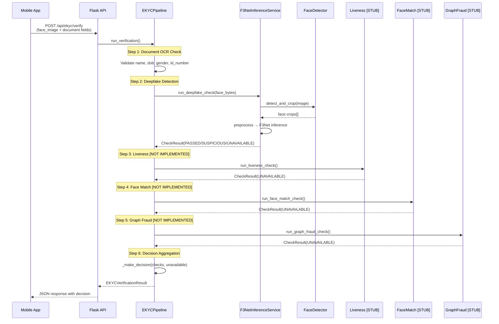
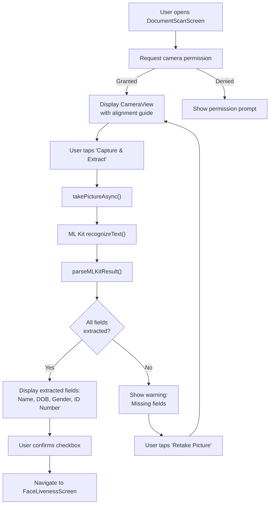
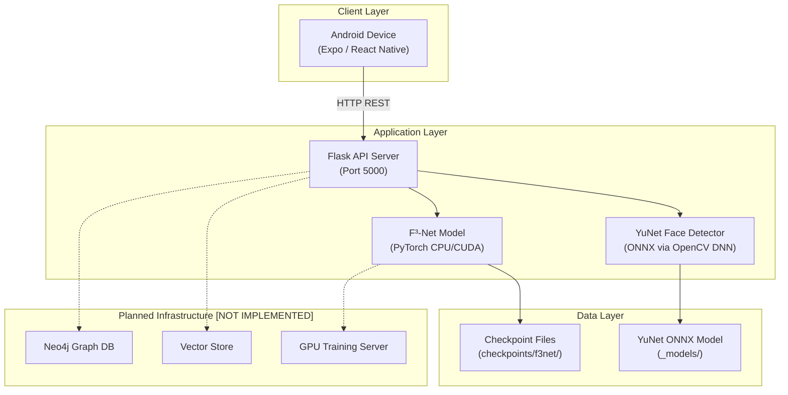
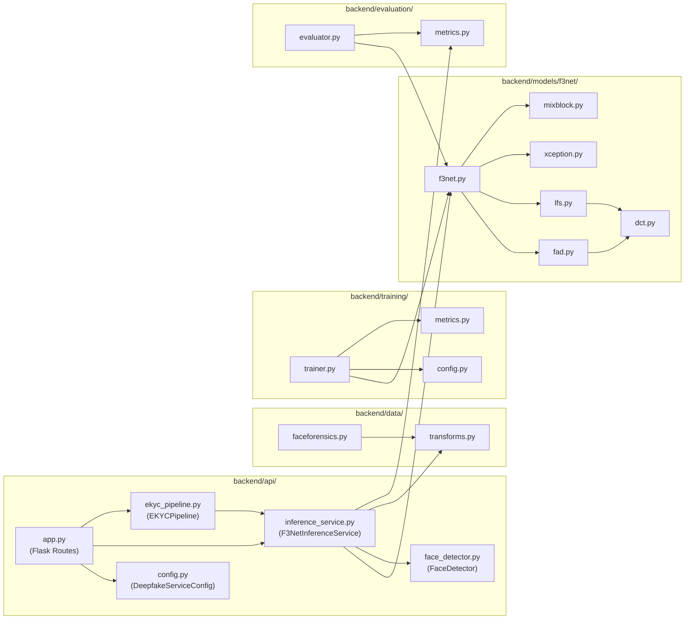
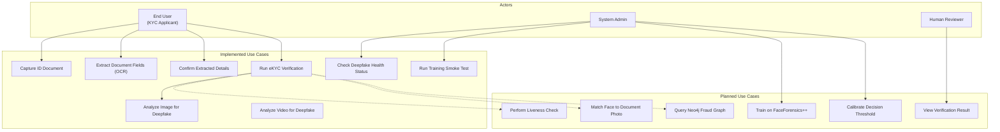
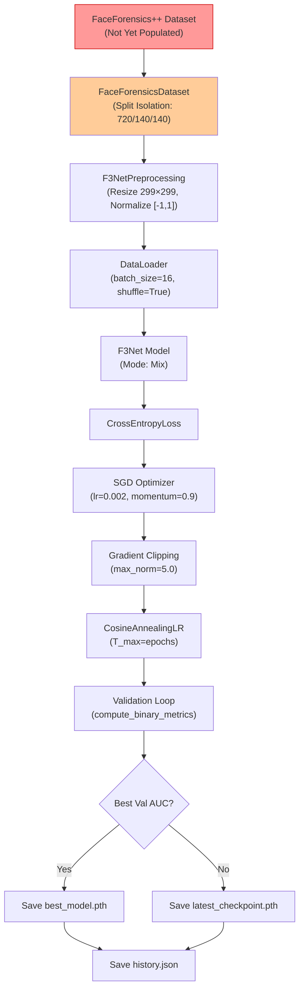

# NeoKYC Architecture Diagrams

All diagrams in this document are rendered using Mermaid and reflect the **actual implementation** found in the repository as of October 2026. Components labelled **[PLANNED]** are referenced in the codebase but have stub or placeholder implementations.

---

## Diagram 1: High-Level System Architecture

**Figure 1.** High-level system architecture of NeoKYC. Solid arrows indicate implemented data flows; dashed arrows indicate planned but not yet implemented connections.

---

## Diagram 2: F³-Net Dual-Stream Architecture

**Figure 2.** Detailed F³-Net dual-stream architecture as implemented in `backend/models/f3net/`. All modules shown are fully implemented and verified via unit tests.

---

## Diagram 3: eKYC Verification Pipeline

**Figure 3.** Sequence diagram for the eKYC verification pipeline. Steps 3–5 are currently stubs returning `UNAVAILABLE` status.

---

## Diagram 4: Document Processing Workflow (Mobile App)

**Figure 4.** Document capture and OCR workflow as implemented in `DocumentScanScreen.tsx`. The OCR parsing uses spatial-aware line extraction with ML Kit Text Recognition.

---

## Diagram 5: Deployment Diagram

**Figure 5.** Deployment topology. The current system runs as a single Flask server with CPU-based PyTorch inference. GPU training, Neo4j, and vector store are planned components.

---

## Diagram 6: Component Diagram

**Figure 6.** Component dependency diagram of the backend Python packages. All shown components are implemented.

---

## Diagram 7: Use Case Diagram

**Figure 7.** Use case diagram. Solid connections represent implemented use cases; dashed connections represent planned use cases.

---

## Diagram 8: Training Pipeline Data Flow

**Figure 8.** Training pipeline data flow. The FaceForensics++ dataset (highlighted in red) has not yet been populated; only a synthetic smoke test has been executed.
